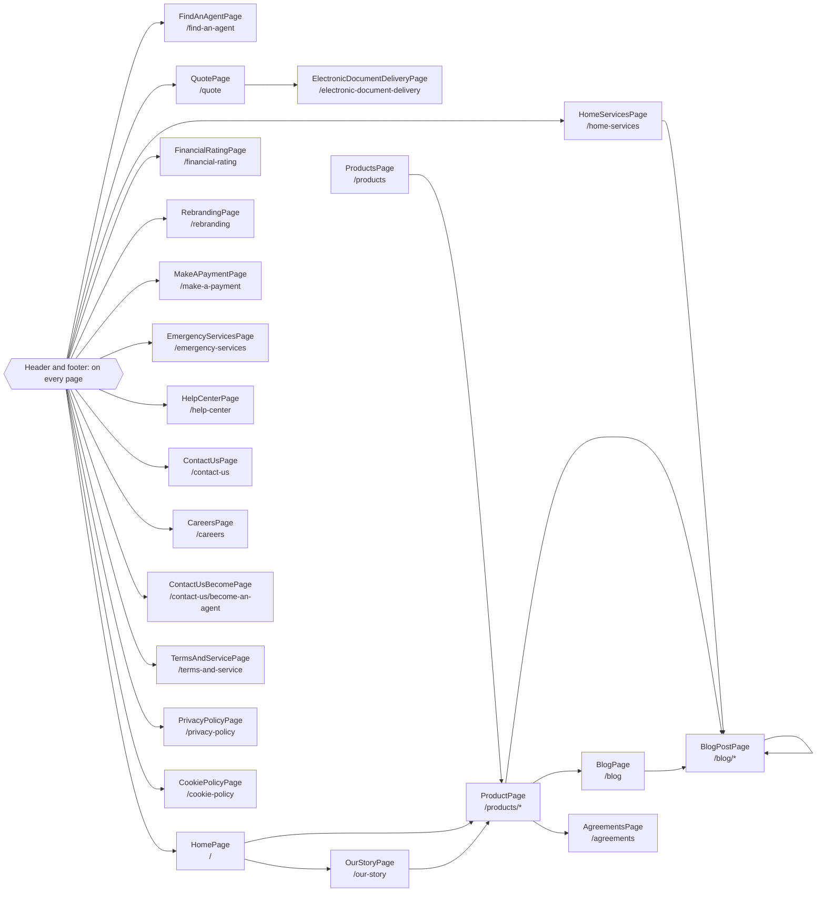

<!-- Generated by Suite Builder. EDIT RULES: do not edit this file; regenerating replaces all of it. Your own notes on the site go in ai/AI-README.md. Creator: https://github.com/ghost-in-the-kernel -->
# The site's shape

https://www.frontlineinsurance.com as the crawl saw it: each box a kind of page (its class and address), each arrow a link
between them. A solid arrow is followed by a navigation test; a dotted one is not, and why is below.
Navigation tests follow 26 of 26 transitions (coverage: transitions);
every kind of page is opened by its smoke test, 22 of 22.

